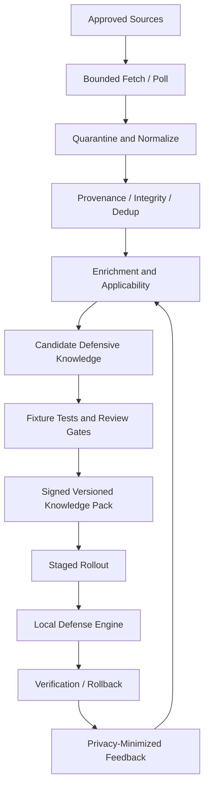

# GODMAN Continuous Defensive Intelligence Pipeline

**Status: design blueprint. Continuous collection, ingestion, promotion and enforcement are not yet implemented.**

## Mission
Keep GODMAN's defensive knowledge current with newly published security information from trusted and approved sources, while preventing untrusted source content from directly controlling the agent, tools or host firewall.

"Continuously" describes the pipeline's goal and freshness-aware scheduling—not a guarantee that every publication is discovered instantly. Source availability, provider rate limits and processing delays must be visible.

## Data flow

## Source categories
- CERT/CSIRT advisories and incident reports.
- Vendor security advisories, patch notes and signed release feeds.
- Reputable threat-intelligence providers with documented provenance and licensing.
- Peer-reviewed security research and responsibly disclosed research writeups.
- Curated open-source detection projects and community rule repositories.
- Standards/framework updates (e.g. ATT&CK and defensive guidance).
- Owner-authorized local incident observations, kept local by default.

A source must be individually registered, reviewed for provenance, access method, terms/license, freshness, reliability, rate limits, and expected content before use.

## Pipeline stages

### 1. Discovery and scheduling
- Use feeds, API endpoints, signed releases, event notifications and bounded polling.
- Use different intervals based on source type, freshness and rate limits; avoid claiming per-second coverage of the whole internet.
- Track last successful fetch, failures, backlog, timestamps and source health.
- Use backoff and cache controls; no aggressive scraping or bypassing access controls.

### 2. Quarantine
- Treat fetched text, HTML, JSON, documents, code snippets and embedded instructions as untrusted data.
- Parse with resource/time/output bounds and isolated processing.
- Do not let source content invoke tools, alter permissions, modify prompts or directly write system policy.
- Avoid executing fetched code or payloads.

### 3. Normalize and provenance
Normalize to a common record: source ID, source URL/reference, publication/update timestamps, content hash, advisory/technique IDs, affected products/platforms, claimed evidence, mitigations, indicators, detection content, confidence, license, expiration and review state.
Deduplicate by identifiers and content hashes; track revisions, withdrawn and superseded records.

### 4. Enrichment
- Cross-reference CVEs, vendor affected-version ranges, ATT&CK technique IDs and platform capability.
- Extract defensive telemetry, detection hypotheses, mitigation steps and verification criteria.
- Score reliability, relevance, freshness, applicability, confidence and conflict.
- Preserve conflicting reports and uncertainty rather than silently choosing one.

### 5. Candidate generation
Produce defensive candidates only:
- advisory summaries and prioritized patch guidance;
- indicators with provenance and expiration;
- reviewed detection-rule updates;
- synthetic test fixtures;
- narrow, explainable firewall-rule proposals;
- configuration-hardening recommendations;
- detection gaps and coverage maps.

Sanitize operational attack instructions and do not ingest runnable offensive payloads or arbitrary commands as executable actions.

### 6. Validation
Candidates must undergo:
- schema and integrity validation;
- signature verification when available;
- platform and version compatibility checks;
- static validation of rule syntax;
- fixture-based regression tests;
- false-positive/false-negative evaluation appropriate to available evidence;
- performance/resource checks;
- conflict and essential-service checks for policy changes;
- review gates appropriate to risk.

### 7. Release and rollout
- Build signed, versioned knowledge packages with manifest, source provenance, checksums, compatibility, changelog and expiry.
- Roll out to staging or canary scope first where practical.
- Promote only after test and health results.
- Use atomic updates, known-good snapshots and rollback.
- Never auto-promote high-impact changes or enforcement rules outside a narrow user-configured policy.
- Report successful, skipped, rejected and failed updates distinctly.

### 8. Local adaptation and feedback
- Local observations and incident results remain private by default.
- A confirmed detection or false-positive result may create a local candidate, but cannot silently become global intelligence.
- Sharing requires explicit consent, minimization, redaction and provenance.
- Review community contributions for source trust, licensing, compatibility and test evidence.
- Never let a feedback loop amplify unverified claims into permanent rules.

## Knowledge model
Each knowledge object includes:
- unique ID and schema version;
- type (advisory, indicator, technique, mitigation, detection, test, policy proposal);
- source/provenance and attribution;
- timestamps and expiry;
- affected platform/products and applicability evidence;
- confidence and quality score, with explanations;
- references and relationships;
- review/validation state;
- version and supersession links.

## Freshness and reliability dashboard
Expose:
- source coverage and health;
- age of latest successful sync per source;
- queue and processing backlog;
- newly discovered and reviewed items;
- rejected items and reason;
- validation failures;
- rule-pack version and rollout status;
- detection coverage changes;
- rollback events;
- false-positive feedback and unresolved conflicts.

## Security and safety boundaries
- No hack-back, unauthorized scanning or attacks against source or alleged attacker infrastructure.
- No fetched content directly instructs GODMAN or invokes tools.
- No executable malware or exploit payloads in operational knowledge packs.
- Firewall updates are defensive, scoped to authorized systems, tested, expiring, auditable and reversible.
- Sensitive host telemetry is not uploaded without explicit consent and disclosure.
- Integrity, signatures, least privilege, action budgets and a kill switch protect the pipeline itself.

## Phased implementation
1. **Phase A:** source registry, manually selected feeds, bounded retrieval, immutable provenance records and safe cache.
2. **Phase B:** normalization, deduplication, timestamps, freshness and source-health reporting.
3. **Phase C:** enrichment, advisory/indicator/mitigation catalog and ATT&CK mapping.
4. **Phase D:** reviewed detection content, fixtures, validation and regression harness.
5. **Phase E:** signed update packages, staging, atomic promotion and rollback.
6. **Phase F:** adaptive firewall integration under user-configured guard policies.
7. **Phase G:** opt-in community contributions and privacy-preserving feedback.

## Completion definition
The pipeline is not complete merely because it can fetch feeds. Completion requires tests for source failures, malformed/untrusted content, rate limits, integrity/signature errors, duplicates and revisions, false positives, compatibility, staging, rollback, privacy, resource limits and permission boundaries, plus honest reporting of coverage and freshness.
